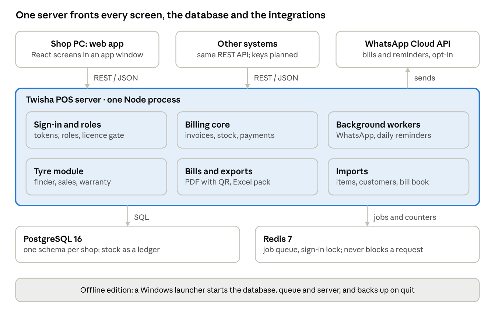

# Twisha POS — Architecture, Performance and Optimization

*As of 29 October 2026. Written for a company's technical and business reviewers.*

## Overview

Twisha POS is billing and counter software for tyre shops and dealers: it takes a customer from a tyre size to a printed GST bill, records each tyre's serial number and warranty, and reminds the shop when a vehicle is due back.

The same code base ships two ways. The **offline edition** is a one-file Windows installer that puts the whole system (web app, server, database, job queue) on the shop's own PC, so billing never depends on the internet or a monthly subscription. The **hosted edition** runs the same server in containers for many shops at once.

The first client runs the offline edition on a shop laptop. Most of the engineering effort described below went into making that case fast to start, safe for the shop's data, and impossible to copy to another PC.

## Integrations and API

Everything the screens do goes through one REST API, and the product already connects to WhatsApp, UPI apps and Excel accounting exports. A real GST e-invoice, an e-way bill and a payment gateway with automatic confirmation are not built yet.

**How the API works**

- REST over HTTP and JSON, grouped by area: sign-in, invoices, products, customers, payments, stock, reports, users, branches and licence, plus a tyre module for the size finder, counter sales, vehicles, warranty claims, reminders and imports. A health endpoint is open.
- Sign-in returns a 15-minute access token and a refresh token. Every other call carries the access token, and the user's role decides what it may do.
- Writes accept an `Idempotency-Key` header, so a retry after a timeout returns the first result instead of posting twice.
- Bad input returns HTTP 422 naming the fields. In production each client address is limited to 500 requests a minute; responses are compressed and carry standard security headers.
- The web app, the end-to-end tests and the demo-data script all use this same API, so it is exercised by every test run.

| Integration | Status | How it works |
| --- | --- | --- |
| WhatsApp bills and reminders | Live, opt-in per shop | Meta's WhatsApp Business Cloud API. The bill PDF goes out as a document or through an approved template; every message is logged and can be retried; a daily job at 09:30 IST sends overdue and service-due reminders |
| UPI scan-and-pay | Live | A standard `upi://pay` link carrying the bill's balance, shown as a QR on screen and printed on the bill. There is no gateway, so staff record the payment after the customer pays |
| Bill PDFs | Live | One endpoint returns a bill as a PDF; Original, Duplicate and Triplicate copies are a parameter |
| Excel accounting pack | Live | One download with up to 11 sheets: sales, items, GSTR-1, HSN summary, credit and debit notes, cancelled bills, purchases, expenses, payments, receivables and stock. It is streamed to a temporary file, so a busy year of bills does not need much memory |
| Bulk imports | Live | Items, customers and the shop's paper bill register can be loaded through the API, with a dry-run option. An optional AI photo scan reads a supplier bill |
| GSTIN lookup | Optional | A third-party lookup that needs an API key and an internet connection; format and checksum checks work offline |
| AI provider | Optional | One adapter that works with Anthropic (the default), a local Ollama model, or any HTTP service that follows a simple contract |
| GST e-invoice (IRN) | Placeholder | The endpoint exists but produces a mock number; no real e-invoice provider is connected |
| E-way bill | Not built | On the roadmap |
| Payment gateway with automatic confirmation | Not built | Payment links were removed from this product on purpose; a gateway with callbacks is the usual next step |

**What a company usually asks for next.** Per-client API keys (today a token is a user's sign-in), webhooks for events such as bill created or payment received, a machine-readable API description (OpenAPI), versioned URLs, and an export for Tally. None of these exist yet. Because every screen already goes through the one API, each is a contained addition rather than a redesign.

## System architecture



The shop's window, or another system, calls the one server over REST and JSON; the server reads and writes PostgreSQL and uses Redis only for queued jobs and counters. WhatsApp is called from the background workers, not from a screen. The UPI QR printed on a bill is only a link: the customer's own UPI app does the payment.

In text form:

```
Shop PC: web app (React) ──REST/JSON──┐
Other systems (keys planned) ─REST/JSON┤
                                       ▼
   ┌─ Twisha POS server · one Node process ──────────────────────┐        WhatsApp Cloud API
   │  Sign-in and roles │ Billing core        │ Background workers ├─sends─▶ (bills, reminders, opt-in)
   │  Tyre module       │ Bills and exports   │ Imports            │
   └───────┬─────────────────────────────────────────┬───────────┘
           │ SQL                                     │ jobs and counters
           ▼                                         ▼
   PostgreSQL 16                              Redis 7
   (one schema per shop; stock as a ledger)   (job queue, sign-in lock; never blocks a request)

Offline edition: a Windows launcher starts the database, queue and server, and backs up on quit.
```

## Data architecture

Each business lives in its own PostgreSQL schema, and a handful of rules keep the numbers correct: stock comes from a ledger, a sale is one transaction, and a repeated click can never sell twice.

- **Schema per tenant.** Shared tables (`tenants`, `refresh_tokens`, `idempotency_keys`) sit in `public`. Every shop gets its own schema (`t_<slug>`), built by a function that can be re-run safely, so upgrading an existing shop only adds what is missing.
- **Billing core plus tyre tables.** Products, suppliers, purchase orders, customers, invoices and payments are the shared billing core. Three tyre tables sit beside them: customer vehicles (with the next service date), one warranty row per serial-numbered tyre sold, and a log of WhatsApp messages.
- **A tyre is a product with attributes** (brand, size, vehicle type, warranty months). A service such as fitting or alignment is a product with no stock. There is no job-card table: a sale is a bill.

| Rule | Why it exists |
| --- | --- |
| Stock is the sum of ledger rows | One figure that the invoice service locks and checks; no counter that can drift |
| Money is stored as exact decimals; business dates are Indian Standard Time | A server running in UTC never shifts a bill to the wrong day |
| A serial number is unique among live warranty rows | Voiding a warranty frees the serial, so a returned tyre can be sold again |
| Every sale carries an idempotency key (the client's, or the content plus a 20-second window) | A double-tap or a retry after a timeout never sells or deducts twice |
| An old tyre taken in exchange is a payment, not a discount | GST stays on the full price, and balances and aging follow the normal payment path |
| Tyre sizes have one canonical spelling, in code and in SQL | `205/55R16`, `205 55 16` and `2055516` all find the same stock |
| Bill fields are validated by strict schemas | An unknown field is rejected instead of silently stored |

A counter sale is one request that validates stock and serial numbers, prices it with GST, creates the invoice under row locks, and then writes the after-sale records (warranty rows, vehicle, exchange). A failure in those follow-up records becomes a warning on the response. The sale itself is never lost.

## Offline deployment

The offline edition is a single installer of about 91 MB (about 434 MB installed) that needs no administrator rights and no internet connection. It carries its own runtime, database and job queue, so nothing on the shop's PC has to be set up first.

| Part | What it is |
| --- | --- |
| Installer | One `Twisha-POS-Setup.exe` built with Inno Setup; installs per user into the user's own folders |
| Runtime | Node 22.11, PostgreSQL 16.4 and Redis 7.2, all bundled next to the program |
| Launcher | A small Windows program (`TwishaPOS.exe`) that shows the start-up window, runs the server, opens the app window and keeps a tray icon with Quit and Backup |
| Control script | A Node command-line tool that checks the laptop, starts the database, queue and server in order, creates the shop on first run, and stops everything cleanly with a backup |
| Web app | The React screens, served by the local server on a private port (4470); the database and queue use their own private ports |

**Where things live.** The program is in `%LOCALAPPDATA%\Programs\Twisha POS`. The shop's data is in `%LOCALAPPDATA%\TwishaPOS`, with logs beside it, and backups go to `Documents\TwishaPOS Backups`. Because data and program are in different folders, an upgrade or an uninstall never touches the shop's bills.

**Upgrades.** Running a newer installer over the old one stops the running copy (taking a backup), closes any leftover Twisha processes so Windows can replace their files, and copies the new program in. On the next start the app finds the existing shop, adds any new database columns, and goes straight to the login.

**Sign-in behaves like a desktop program.** The session is kept only while the window is open: closing the app signs the user out, and the next start asks for the PIN again.

## Performance and optimization

On the client's laptop, start-up after a Windows restart took one to two minutes at first. After the changes below the server is ready 2.4 to 3.4 seconds after the launcher starts, and the app opens in about 10 seconds on screen including Windows' own start-up work. Every figure here was measured, and the sources are noted.

The cause was not the database or the business logic. The server loaded about 2,400 small files from disk at every start, and on a slow laptop with live virus scanning each file was expensive.

| Problem found | What we changed | Measured effect |
| --- | --- | --- |
| About 2,400 files opened at every start; server start took 31 to 51 s on the laptop | Pre-built the server into one 9.6 MB file; about 580 files are opened at start | Developer-PC restart 6.8 s to 4.6 s; the largest gain on the laptop |
| Code compiled again at every start | Switched on Node's compile cache | Part of the 4.6 s above |
| One-time checks repeated, and database tools launched only to ask whether it was up | Checks remembered in a small marker file; the database is probed over its network port | Saves seconds on slow disks (not measured separately) |
| Database and server started one after the other | They start side by side; the server waits for the database itself; polling every 250 ms | Developer-PC restart 4.6 s to about 2.3 s |
| PDF and Excel libraries loaded at start | Loaded the first time a bill or export needs them | Server code ready in 0.5 s instead of 1.7 s on the developer PC |
| Windows scanned every Twisha file as it was first read | The two Twisha folders were excluded from scanning (done by hand on the laptop) | Server code load 6 to 16 s down to 1.5 to 2.6 s; ready after launch 8 to 22 s down to 2.4 to 3.4 s |
| Database stopped uncleanly when Windows restarted | A clean, fast stop when Windows signs out or restarts | Recovery measured at about 0.1 s, so a small gain; a misleading "checking itself" message was corrected |

The laptop's three consecutive restarts, before the scanning exclusion, were 22 s, 12 s and 8 s: the first start after boot is slowest because Windows is still loading its own programs and caching files.

**Run-time paths that were also tuned**

- **Bill search** uses two index-driven look-ups (bill number, customer name or mobile, matching from the start of the text), and the result count stops at 10,000.
- **Bill PDFs** are drawn on demand by a pure-JavaScript library, with no browser engine and no queue. A typical bill takes 60 to 130 ms; the first one after start takes about 0.5 s while fonts load.
- **Excel exports** are streamed to a temporary file, so a large export does not hold the whole workbook in memory.
- **Redis can never block a request.** Request paths use a client that gives up in about 1.5 seconds and queues nothing; only background workers wait patiently. With Redis stopped, sign-in, a sale, a PDF, an export and the charts all still answer.
- **Stock and duplicate protection** use one ledger figure and an idempotency key, which avoids both stale counters and double-posting under repeated clicks.

**Not yet done**

- The tyre product has not been load-tested with 100,000 or more bills.
- The web app ships as one 1.8 MB script; splitting it by screen would shave the first load.
- The scanning exclusion is manual; an optional installer step that asks the owner first is designed but not built, because it changes a security setting.

## Reliability and data safety

The shop's bills are protected in layers: a backup whenever the app is quit, a clean database stop whenever Windows shuts down, and a design in which a failed side-effect can never lose a sale.

- **Backups.** Quitting from the tray icon stops the app and takes a database backup into `Documents\TwishaPOS Backups`. A "Back up now" shortcut and a "Restore a backup" shortcut are in the Start menu, and the backups folder is separate from the program folder.
- **Clean shutdown.** When Windows signs out or restarts, the launcher stops the database quickly and cleanly, so the next start has nothing to repair.
- **Crash tolerance.** If the power is cut, PostgreSQL replays its log on the next start; the launcher waits for the database to accept connections instead of failing on the first refusal.
- **A sale is one transaction, and side-effects cannot undo it.** Stock, numbering, party balance and payments are written together under row locks. Warranty rows, the vehicle record and the exchange entry are written afterwards, and if one fails the response carries a warning instead of cancelling the bill.
- **Duplicate protection.** A double-click, a retry after a timeout or a replay returns the first result instead of selling again.
- **Redis is optional at request time.** If the queue is down, bills, PDFs and reports keep working; only WhatsApp delivery waits, and it reports "queue unreachable" instead of hanging.
- **Safe upgrades.** The installer stops the running copy, takes a backup, and closes every Twisha process before replacing files, which prevents the "file in use" failure that stopped one earlier upgrade.
- **Records are not deleted by accident.** A returned tyre voids its warranty row; a cancelled bill reverses stock and balance; a bill date must be a real day, not in the future and not older than a year.

One gap to be aware of: the backup folder is on the same PC as the data. A shop should copy backups to a second place, such as a pen drive or cloud folder, until an automatic off-site copy is added.

## Security and licensing

Access is controlled by role and by business, input is validated before it reaches the database, and the offline edition only runs on the PC its signed licence names.

- **Roles.** The owner and manager can change settings, void warranties and sell below cost. A cashier can sell and record claims. A viewer is read-only everywhere: one server-side check blocks every write from a viewer, so individual screens cannot forget it.
- **Business isolation.** Every business has its own database schema, every query carries the business and branch, and a test suite tries to read one shop's data from another.
- **Hostile input.** Raw SQL is parameterised, bill and item schemas are strict, and NUL characters are rejected up front. The test suites feed the API deliberately hostile strings and cross-business requests.
- **Sign-in lock.** Five wrong PINs lock the account for 15 minutes. The owner or a manager can unlock it from the Staff screen, and a command-line tool unlocks an owner who is locked out of everything.
- **Secrets.** The licence signing key is kept outside every repository and never goes into an installer.

**Machine-locked licence.** A licence is one line of text signed with a private key that only the software owner holds; the app contains only the public key, so it can check a licence but nobody can make one.

| Item | How it works |
| --- | --- |
| What is signed | Product, shop name, Machine ID, issue date and expiry date, with an Ed25519 signature |
| Machine ID | A short code made from the Windows machine identifier and the PC's BIOS details; a copy of the installer on another PC shows "activate" and does nothing else |
| Enforcement | Every server call except the licence calls returns 402 until a valid licence is activated; the check is on in the installed app only |
| Clock protection | If the PC's date is set back by more than a day, the licence is refused |
| First run | The installer's own set-up step passes a one-time key so it can create the shop before any licence exists |
| Renewal | A new licence for the same Machine ID with a later expiry replaces the old one when pasted in |

**Honest limits.** The licence stops casual sharing of the installer or the installed folder. It does not stop a skilled developer who edits the program to remove the check, because the server is a readable bundle. Planned hardening: obfuscating the bundle, repeating the check in more places and in the launcher, per-customer builds with a visible licence ID, and an optional online check-in for remote revoke and renewal reminders.

## Quality and testing

The full API test run on 29 October 2026 passed: 14 suites, 387 tests. Browser checks on top of that open every screen at real laptop sizes, and the printed bill is compared with the shop's own Excel sheet.

| Layer | What it checks |
| --- | --- |
| API test suites (387 tests) | The tyre module, roles and permissions, validation, hostile strings, one shop reading another's data, races and repeated requests, purchasing, payments, returns, expenses, staff, reports, the Excel pack, imports, warranty claims, and the removed features staying removed |
| Paper-book replay | The shop's own bill book (car and two-wheeler sheets) is replayed through the API, and totals, taxable value and GST are compared with the sheet's own formulas |
| Bill layout tests | The printed bill's boxes, headings, figures, copies (Original, Duplicate, Triplicate), long bills and the payment QR; the bill is also compared with Excel's own export, with positions held within 0.4 % of the page width |
| Browser crawl | Every screen opened as owner, manager and viewer, and at phone size, reporting crashes, stuck loaders, failed requests and console errors |
| Counter flows | The real New Sale screen: a bill, a double-tap, an empty bill, credit with no customer, an expired session, a read-only user; and a warranty claim from sale to replacement |
| Small-screen check | 28 screens at four laptop sizes (down to 1024 by 576), plus the popups that were once cut off: 112 page visits per run |
| Payment QR check | The QR is read back from a screenshot and from the bill PDF, as a phone camera would, and its amount is compared with the bill |
| Packaged-app check | The built installer is run on clean data: it refuses to run without a licence, refuses another PC's licence, accepts the right one, then a sale and its PDF with the QR work |

What is not automated yet: installing a new version over a copy that holds real bills (done by hand, with a backup first), and load testing with 100,000 or more bills.

## Billing, payments and warranty

The counter flow is built around how a tyre shop actually bills: one screen takes a size, a vehicle, fitting jobs, an old tyre and the payment, and produces the shop's own bill format.

| Area | What it does |
| --- | --- |
| Bill format | The printed bill is the shop's Excel bill book redrawn: the same columns, row heights, borders and number formats, in a tax-invoice frame with amounts in words, bank details and warranty and claim terms. Tax invoices and cash memos use the same frame, and long bills continue onto further pages with the totals on the last one |
| Scan-and-pay QR | Every sale bill prints a QR: for the balance when something is still due, otherwise the shop's plain QR with no amount (a setting can limit it to bills with a balance). "Show QR to customer" on the bill and on New Sale shows it full-screen in the layout of the shop's own bank QR sheet, so the customer's phone opens with the amount filled in |
| Credit and part payment | Cash, UPI, card, bank, cheque, split payment and credit with a due date; balances and aging follow the customer |
| Old-tyre exchange | Recorded as a payment with the old tyres stocked as scrap; GST stays on the full price |
| Warranty and claims | One warranty row per serial-numbered tyre, with the end date set from the item or the shop default. A claim can be sent to the tyre company, closed with a replacement that takes stock out and creates a linked warranty row, and is reported on its own screen |
| Vehicles and reminders | Each bill updates the vehicle's next service, alignment and balancing dates; the shop sees what is due and can send a WhatsApp reminder |
| Reprints | Original, Duplicate and Triplicate copies from the Reprint menu, or a PDF for sending |
| WhatsApp | The bill goes out as the same PDF, so the QR travels with it; sending is opt-in per shop |
| Reports | Sales by size, brand and vehicle type, dead stock, receivables, and the Excel accounting pack for the shop's accountant |

## Operations and next steps

Delivering to a new shop takes six steps, and every step has a tool or a log behind it, so a slow or failed start can be diagnosed without being on site.

1. The shop runs a small helper that prints the laptop's Machine ID.
2. The owner of the software issues a licence for that ID and an end date (a licence register is kept in the project documents).
3. The shop runs the installer.
4. The shop pastes the licence into the activate screen.
5. In My Business, the shop enters its bank details, UPI ID and optional bank banner.
6. The shop takes a first backup and confirms it appears in the backups folder.

**Diagnostics.** Every start writes timing lines to a set-up log and an API log (how long the server code, routes and database took), and the database and queue keep their own logs, all in one folder. A slow-start tool gathers the evidence in one file, and a version checker shows which version and folder is installed, which is running, and where the shortcuts point. Together they let a remote developer tell "old files" from "slow laptop" from "wrong shortcut".

**Known limits**

- One business per installation; the offline edition is Windows-only.
- Backups sit on the same PC until an off-site copy is added.
- The licence deters copying but is not tamper-proof.
- The hosted edition's deployment files carry placeholder host names that must be set before use.

**Roadmap, in the order a company is likely to ask**

1. Integration surface: API keys per client, webhooks, an OpenAPI description, versioned URLs.
2. Real GST integrations: e-invoice and e-way bill through a provider, and a payment gateway with automatic confirmation.
3. Operations: automatic off-site backup, an installer step for the scanning exclusion, a load test at 100,000 bills, splitting the web app by screen.
4. Licence hardening: obfuscation, per-customer builds and an optional online check-in.
5. Shop features: stock lots by manufacture date, barcode and QR on tyres, retreading job cards, a Tally export.

